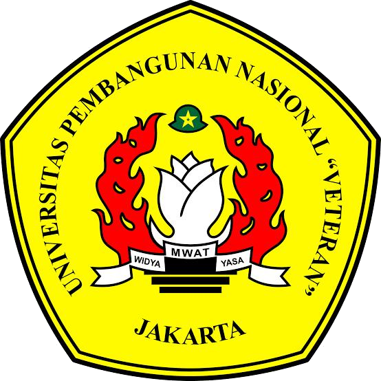
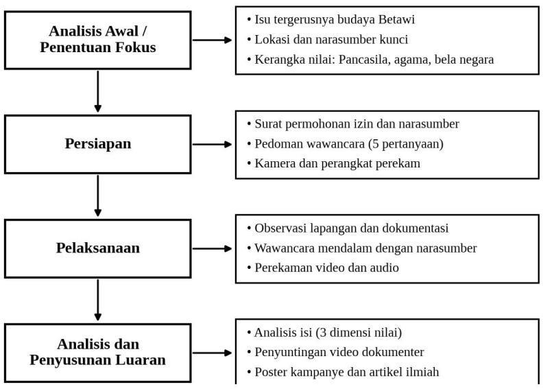

<div align="center">



# Akar Betawi, Cakrawala Global

**Strategi Pelestarian Budaya Betawi di Era Globalisasi melalui Nilai Pancasila, Agama, dan Bela Negara**

Artikel Project-Based Learning (PjBL) · Kelompok 2 (Sam Ratulangi) · Kelas D
D3 Sistem Informasi, Fakultas Ilmu Komputer, UPN "Veteran" Jakarta · 2026

[](paper/artikel-kelompok-2-pjbl.pdf)
[](paper/artikel.md)
[](CITATION.cff)


[**Baca artikel (PDF)**](paper/artikel-kelompok-2-pjbl.pdf) · [**Versi teks**](paper/artikel.md) · **Landing page:** belum terbit

</div>

---

## Ringkasan

Penelitian ini mengkaji tantangan pelestarian budaya Betawi di tengah globalisasi serta bagaimana nilai Pancasila, nilai agama, dan bela negara nonmiliter tercermin dalam upaya pelestariannya. Data dikumpulkan melalui observasi lapangan di kawasan **Setu Babakan, Jakarta**, wawancara mendalam dengan pegiat pelestari budaya Betawi, **Bang Jaka**, serta studi pustaka, lalu dikemas dalam video dokumenter, poster kampanye, dan artikel ini.

> **Tesis utama:** berpijak pada yang lokal, bertindak secara global. Budaya luar tidak ditakuti, melainkan dipelajari agar unsur lokal dan global digabungkan tanpa meninggalkan pakem tradisional.

**Kata kunci:** budaya Betawi · pelestarian budaya · globalisasi · Pancasila · bela negara

## Tiga Dimensi Analisis

| Dimensi | Fokus |
|---|---|
| **Konservasi Budaya Betawi** | Menjaga pakem tradisi lewat revitalisasi, keterlibatan generasi muda di sanggar dan festival, serta dukungan pemerintah dan masyarakat. |
| **Internalisasi Pancasila** | Sila Ketiga (persatuan dan perekat identitas) dan Sila Kelima (akses serta penghargaan yang adil atas warisan budaya). |
| **Transendensi Nilai Religi** | Budaya sebagai wadah nilai kejujuran, tanggung jawab, kesabaran, dan rasa hormat. |

## Temuan Utama

- **Teknologi sebagai peluang, bukan ancaman.** Cerita budaya yang dahulu hanya terdengar sampai kampung sebelah kini dapat menjangkau luar negeri melalui media sosial.
- **Bukan tidak peduli, tetapi belum dikenalkan.** Setelah diperkenalkan dan diberi cerita, generasi muda cenderung tertarik. Prinsipnya: *kenal maka sayang*.
- **Generasi muda sebagai penjembatan antargenerasi.** Mereka mengolah cerita masa lalu menjadi modal cerita masa depan.
- **Bela negara nonmiliter** diwujudkan melalui kontribusi nyata: video dokumenter, poster kampanye, dan publikasi media sosial.

## Alur Kegiatan



## Anggota Kelompok

| No | Nama | NIM |
|:--:|------|-----|
| 1 | Ayu Safitri | 2610501106 |
| 2 | Dondy Amru Perwoko | 2610501115 |
| 3 | Keysya January Christy | 2610501120 |
| 4 | Kayla Raisya Putri | 2610501112 |
| 5 | Mahdiya Farha Imani | 2610501131 |
| 6 | Milano Arrafi Islam | 2610501125 |
| 7 | Muhammad Alif Nadhir Fadhilah | 2610501123 |
| 8 | Muhammad Fahrizal | 2610501119 |
| 9 | Muhammad Iqfal Gusdian | 2610501135 |
| 10 | Ryanti Anggriani | 2610501130 |

**Dosen pembimbing:** Fajar Setyaning Dwi Putra, M.Pd · Khozinatun Masfufah, S.Pd.I, M.A · Ir. Yuliana Yuli Wahyuningsih, M.M., M.H.

## Media dan Dokumentasi

| Kanal | Tautan |
|---|---|
| Video dokumenter (YouTube) | `[ISI LINK YOUTUBE]` |
| Instagram kelompok | `[ISI LINK INSTAGRAM]` |
| Poster kampanye | Dalam proses |

> Ganti teks `[ISI LINK ...]` dengan URL asli setelah akun dipublikasikan.

## Struktur Repositori

```
.
├── index.html                    # Landing page (GitHub Pages)
├── paper/
│   ├── artikel-kelompok-2-pjbl.pdf
│   └── artikel.md                # Versi teks yang bisa dibaca langsung
├── assets/
│   ├── css/style.css
│   ├── js/main.js
│   └── img/
│       ├── logo-upnvj.png
│       └── skema-kegiatan.png
├── CITATION.cff
└── README.md
```

## Sitasi

Jika artikel ini bermanfaat, silakan kutip sebagai:

```bibtex
@article{safitri2026akarbetawi,
  title   = {Akar Betawi, Cakrawala Global: Strategi Pelestarian Budaya Betawi
             di Era Globalisasi melalui Nilai Pancasila, Agama, dan Bela Negara},
  author  = {Safitri, Ayu and Perwoko, Dondy Amru and Christy, Keysya January
             and Putri, Kayla Raisya and Imani, Mahdiya Farha and Islam, Milano Arrafi
             and Fadhilah, Muhammad Alif Nadhir and Fahrizal, Muhammad
             and Gusdian, Muhammad Iqfal and Anggriani, Ryanti},
  year    = {2026},
  note    = {Artikel Project-Based Learning, D3 Sistem Informasi, UPN Veteran Jakarta},
  url     = {https://github.com/USERNAME/REPO_NAME}
}
```

Metadata lengkap tersedia di [`CITATION.cff`](CITATION.cff).

## Menjalankan Landing Page

Buka `index.html` langsung di browser, atau jalankan server lokal:

```bash
python3 -m http.server 8000
```

Lalu buka `http://localhost:8000`.

## Publikasi ke GitHub Pages

1. Buat repositori baru di GitHub, lalu unggah seluruh isi folder ini.
2. Masuk ke **Settings → Pages**.
3. Pada **Source**, pilih branch `main` dan folder `/ (root)`, lalu **Save**.
4. Ganti `USERNAME` dan `REPO_NAME` di README, `CITATION.cff`, dan tag Open Graph pada `index.html` dengan akun serta nama repo kamu.

---

<div align="center">

© 2026 Kelompok 2 PjBL (Sam Ratulangi), Kelas D, D3 Sistem Informasi, UPN "Veteran" Jakarta.

</div>
