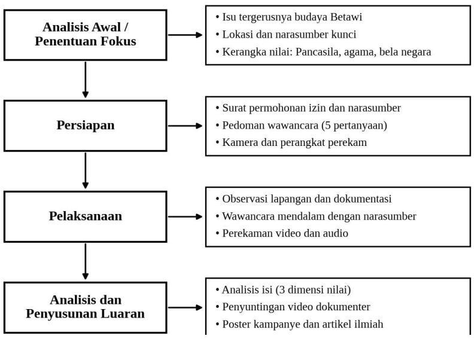

# Akar Betawi, Cakrawala Global: Strategi Pelestarian Budaya Betawi di Era Globalisasi melalui Nilai Pancasila, Agama, dan Bela Negara

**Ayu Safitri; Dondy Amru Perwoko; Keysya January Christy; Kayla Raisya Putri; Mahdiya Farha Imani; Milano Arrafi Islam; Muhammad Alif Nadhir Fadhilah; Muhammad Fahrizal; Muhammad Iqfal Gusdian; Ryanti Anggriani; Fajar Setyaning Dwi Putra, M.Pd; Khozinatun Masfufah, S.Pd.I, M.A; Ir. Yuliana Yuli Wahyuningsih, M.M., M.H.**

D3 Sistem Informasi, Fakultas Ilmu Komputer, Universitas Pembangunan Nasional "Veteran" Jakarta
E-mail: 2610501106@mahasiswa.upnvj.ac.id

---

## Abstrak

Penelitian ini mengkaji tantangan pelestarian budaya Betawi di tengah globalisasi serta bagaimana nilai Pancasila, nilai agama, dan bela negara nonmiliter tercermin dalam upaya pelestariannya. Dengan pendekatan kualitatif deskriptif dan analisis isi (content analysis), data dikumpulkan melalui observasi lapangan di kawasan Setu Babakan, Jakarta, wawancara mendalam dengan pegiat pelestari budaya Betawi, Bang Jaka, serta studi pustaka, yang didokumentasikan dalam video dokumenter pendek. Wawancara menunjukkan bahwa pelestarian perlu berpijak pada budaya lokal namun bertindak secara global: budaya luar tidak ditakuti melainkan dipelajari agar unsur lokal dan global dapat digabungkan tanpa meninggalkan pakem tradisional. Pelestarian juga dipandang sebagai pengamalan nilai Pancasila, nilai agama, dan bela negara nonmiliter. Artikel ini menawarkan paradigma pelestarian yang menjaga akar budaya Betawi sembari membuka cakrawala global melalui revitalisasi, digitalisasi, dan diplomasi budaya.

**Kata Kunci:** budaya Betawi, pelestarian budaya, globalisasi, Pancasila, bela negara

---

## Pendahuluan

Perkembangan teknologi dan globalisasi membawa arus budaya asing yang masuk ke Indonesia dan perlahan menggerus budaya asli bangsa (Nahak, 2019). Budaya Betawi, sebagai budaya masyarakat asli Jakarta, termasuk yang menghadapi tekanan tersebut. Pembangunan kota yang sangat modern sering menggusur ruang-ruang komunal tempat budaya diwariskan, seperti perkampungan, majelis taklim, dan sanggar seni (Hidayat & Nugroho, 2023).

Tantangan lain datang dari kesenjangan antargenerasi. Generasi muda, khususnya Gen Z dan Alpha, tumbuh dalam ekosistem digital yang dipenuhi budaya populer global, sedangkan tradisi Betawi cenderung hanya muncul dalam acara seremonial dan kehilangan fungsi sosialnya (Pratama & Wijaya, 2022). Jika dibiarkan, kondisi ini berpotensi membawa budaya Betawi pada komodifikasi yang dangkal atau bahkan kepunahan kultural.

Menghadapi realitas tersebut, strategi pelestarian tidak boleh lagi bersifat pasif atau sekadar romantisme masa lalu. Diperlukan paradigma baru, yaitu menjaga akar Betawi secara kokoh sembari membuka cakrawala global melalui revitalisasi, digitalisasi, dan diplomasi budaya. Pelestarian budaya juga dapat dibaca sebagai pengamalan nilai Pancasila, nilai agama, dan bentuk bela negara nonmiliter, yaitu mempertahankan nilai luhur bangsa dari erosi identitas akibat globalisasi (Kaelan, 2022; Pardede dkk., 2023; UU No. 23 Tahun 2019).

Oleh karena itu, penelitian berbasis proyek (Project-Based Learning/PjBL) ini bertujuan (1) mengetahui tantangan kehidupan berbudaya di tengah globalisasi, (2) mengetahui penerapan nilai Pancasila dan agama dalam pelestarian budaya Betawi, dan (3) memahami bentuk bela negara yang dapat dilakukan melalui kontribusi kepada masyarakat. Hasilnya dikemas dalam video dokumenter, poster kampanye, dan artikel ilmiah ini.

## Metode Pelaksanaan

Kegiatan ini menggunakan pendekatan kualitatif deskriptif dengan analisis isi (content analysis) untuk memotret upaya pelestarian budaya Betawi di tengah globalisasi (Moleong, 2021). Pendekatan ini menggabungkan observasi lapangan langsung, dokumentasi visual (video dan foto), serta wawancara mendalam sebagai instrumen utama pengumpulan data. Narasumber kunci adalah Bang Jaka, pegiat pelestari budaya Betawi di kawasan Setu Babakan, Jakarta.

Prosedur pelaksanaan dibagi ke dalam tiga tahapan utama:

1. **Tahap Perizinan dan Koordinasi:** tim menyiapkan surat permohonan izin kegiatan dari universitas dan surat permohonan wawancara kepada narasumber agar pelaksanaan observasi dan wawancara berjalan secara resmi.
2. **Tahap Pengumpulan Data dan Dokumentasi:** data primer diperoleh melalui observasi lapangan dan wawancara mendalam dengan pedoman wawancara yang terdiri atas lima pertanyaan, yaitu tantangan terbesar pelestarian, alasan generasi muda lebih tertarik pada budaya asing, upaya pelestarian dan cara menarik minat generasi muda, pemanfaatan teknologi dan media sosial, serta kaitan pelestarian budaya dengan nilai Pancasila dan bela negara. Seluruh kegiatan direkam dengan kamera dan perangkat perekam suara.
3. **Tahap Analisis dan Produksi Media:** data wawancara dan visual dianalisis secara deskriptif kualitatif menggunakan tiga dimensi, yaitu Konservasi Budaya Betawi, Internalisasi Pancasila (Sila Ketiga dan Kelima), dan Transendensi Nilai Religi (kejujuran, tanggung jawab, kesabaran, dan rasa hormat). Hasilnya dikemas menjadi video dokumenter, poster kampanye, dan artikel ini.

Alur pelaksanaan kegiatan disajikan pada Gambar 1. Sumber sekunder berupa buku, jurnal, artikel, dan peraturan perundang-undangan yang berkaitan dengan budaya, Pancasila, agama, dan bela negara digunakan untuk memperkuat konteks dan analisis.

## Hasil dan Capaian

### 1. Hasil Kegiatan

Kegiatan observasi dan wawancara dilaksanakan di kawasan Setu Babakan, Jakarta, pada Kamis, 22 Oktober 2026. Wawancara dilakukan dengan Bang Jaka menggunakan lima pertanyaan inti. Capaian pelaksanaan kegiatan dan luaran proyek dirangkum pada Tabel 1.

**Tabel 1. Capaian Pelaksanaan Kegiatan dan Luaran**

| No | Kegiatan/Luaran | Keterangan | Status |
|----|-----------------|------------|--------|
| 1 | Surat permohonan izin universitas | Izin pelaksanaan kegiatan di lapangan | Selesai |
| 2 | Surat permohonan narasumber | Permohonan wawancara kepada narasumber | Selesai |
| 3 | Surat keterangan penggunaan AI dan pernyataan tidak ada konflik kepentingan | Kelengkapan administrasi proyek | Selesai |
| 4 | Wawancara narasumber | Wawancara dengan Bang Jaka pada 22 Oktober 2026 (lima pertanyaan) | Terlaksana |
| 5 | Akun publikasi kelompok | Akun Instagram dan YouTube kelompok | Dibuat |
| 6 | Video dokumenter | Dokumentasi dan penyuntingan video wawancara | Selesai |
| 7 | Poster kampanye | Ajakan bangga dan peduli terhadap budaya sendiri | Dalam proses |
| 8 | Artikel ilmiah | Artikel hasil kajian ini | Selesai |

Ringkasan hasil wawancara dengan narasumber disajikan pada Tabel 2.

**Tabel 2. Ringkasan Hasil Wawancara dengan Bang Jaka**

| No | Topik Pertanyaan | Ringkasan Jawaban Narasumber |
|----|------------------|-------------------------------|
| 1 | Tantangan terbesar pelestarian budaya Betawi di tengah globalisasi | Menurut narasumber, teknologi justru mempermudah pelestarian karena cerita yang dahulu hanya terdengar sampai kampung sebelah kini dapat menjangkau luar negeri melalui media sosial. Pekerjaan rumah yang tersisa adalah memberi pemahaman kepada generasi muda bahwa mereka merupakan penjembatan antara generasi terdahulu dan generasi mendatang, sehingga mampu mengolah cerita masa lalu menjadi modal cerita masa depan, apalagi bahasa antargenerasi berbeda. |
| 2 | Pandangan terhadap budaya asing dan budaya lokal | Berpijak pada yang lokal tetapi bertindak secara global. Budaya luar tidak perlu ditakuti, melainkan dipelajari untuk menemukan bagian yang dapat digabungkan dengan budaya lokal. Karena jangkauan budaya kini melampaui batas kampung, budaya Betawi perlu disampaikan dengan bahasa yang dipahami pihak luar agar diterima, tanpa meninggalkan pakem tradisional. Tradisi yang dianggap kuno dapat menyatu dengan yang modern. |
| 3 | Upaya pelestarian dan cara menarik minat generasi muda | Narasumber menilai generasi muda tidak bisa disalahkan karena bukan tidak mau, melainkan belum dikenalkan pada budaya Betawi. Setelah diperkenalkan dan diberi cerita, mayoritas menanggapi bahwa budaya Betawi ternyata menarik. Garis besarnya: kenal maka sayang. |
| 4 | Pemanfaatan teknologi dan media sosial tanpa menghilangkan nilai asli | Narasumber menegaskan bahwa kini tidak ada lagi alasan bagi anak muda untuk tidak ikut melestarikan budaya. Dahulu orang harus datang ke suatu tempat, berguru, serta menyiapkan waktu dan biaya. Sekarang cukup dengan ponsel dan media sosial: sebagian waktu menelusuri media sosial dapat dipakai untuk mencari wawasan dan membagikan ulang konten budaya. Informasi digital menyebar dan tersimpan, sehingga secara tidak langsung ikut melestarikan, meski belajar langsung tetap ideal. |
| 5 | Pelestarian budaya sebagai penerapan Pancasila dan bela negara, serta pesan untuk generasi muda | Narasumber menyebut budaya sebagai ciri tingkat peradaban: semakin tinggi budaya, semakin tinggi peradaban, dan nilai kebersamaan serta persatuan ikut meningkat. Beliau memperkenalkan istilah "rabun budaya", yaitu orang yang berada di depan budayanya tetapi belum memahaminya. Yang dibutuhkan adalah penjembatan agar generasi muda dapat membaca dan mengenal budaya itu dengan lebih jelas. |

### 2. Pembahasan

**Tantangan pelestarian.** Tantangan pelestarian budaya Betawi bersumber dari faktor struktural dan kultural. Secara struktural, urbanisasi dan pembangunan kota menyempitkan ruang pewarisan budaya (Hidayat & Nugroho, 2023). Secara kultural, regenerasi pelaku seni berjalan lambat dan tradisi lebih sering hadir sebagai tontonan seremonial (Pratama & Wijaya, 2022).

**Minat generasi muda.** Kecenderungan generasi muda pada budaya asing dapat dijelaskan oleh ekosistem digital yang menyajikan konten global secara masif, mudah diakses, dan dikemas menarik, sementara budaya lokal sering dipersepsikan kurang relevan. Persoalannya lebih pada keterpaparan dan cara penyajian daripada ketidakpedulian generasi muda. Narasumber menegaskan bahwa budaya luar tidak perlu ditakuti, tetapi dipelajari agar unsur lokal dan global dapat digabungkan. Prinsip berpijak pada yang lokal sambil bertindak secara global ini sejalan dengan paradigma Akar Betawi, Cakrawala Global: budaya Betawi perlu "berbicara dengan bahasa mereka" agar dapat diterima publik yang lebih luas, tanpa meninggalkan pakem tradisionalnya.

**Upaya dan strategi.** Upaya pelestarian yang efektif menggabungkan penjagaan keaslian tradisi dengan penyajian yang dekat dengan dunia anak muda, sejalan dengan strategi revitalisasi pada paradigma Akar Betawi, Cakrawala Global. Keterlibatan langsung generasi muda dalam sanggar, pertunjukan, dan festival, disertai dukungan pemerintah dan apresiasi masyarakat kepada seniman, menjadi syarat keberlanjutan.

**Teknologi dan media sosial.** Teknologi membuka ruang baru bagi pelestarian melalui dokumentasi digital, konten kreatif, dan promosi lintas wilayah, sesuai strategi digitalisasi dan diplomasi budaya. Agar nilai asli tidak hilang, konten perlu bersumber dari pelaku budaya dan menjelaskan makna di balik tradisi, bukan sekadar mengejar popularitas yang berujung pada komodifikasi dangkal.

**Pancasila, agama, dan bela negara.** Melestarikan budaya Betawi mengamalkan Sila Ketiga karena budaya menjadi perekat identitas dan persatuan, serta Sila Kelima karena warisan budaya perlu dapat diakses dan dihargai secara adil (Kaelan, 2022). Dari sisi agama, budaya menjadi wadah bagi nilai kejujuran, tanggung jawab, kesabaran, dan saling menghormati (Pardede dkk., 2023). Dari sisi bela negara, menjaga budaya dari erosi identitas akibat globalisasi merupakan bela negara nonmiliter sebagaimana dimaksud dalam UU No. 23 Tahun 2019.

Dengan demikian, pelestarian budaya Betawi yang efektif memerlukan sinergi antara seniman, generasi muda, masyarakat, dan pemerintah, dengan memanfaatkan teknologi secara bijak dan berlandaskan nilai kebangsaan dan keagamaan.

**Tiga dimensi analisis.** Jika dibaca melalui tiga dimensi analisis, pada dimensi Konservasi Budaya Betawi pelestarian dilakukan dengan menjaga pakem tradisi sekaligus menghadirkannya lewat revitalisasi, keterlibatan generasi muda di sanggar dan festival, serta dukungan pemerintah dan masyarakat. Pada dimensi Internalisasi Pancasila, upaya tersebut mengamalkan Sila Ketiga (persatuan dan perekat identitas) dan Sila Kelima (akses dan penghargaan yang adil atas warisan budaya). Pada dimensi Transendensi Nilai Religi, budaya menjadi wadah bagi kejujuran, tanggung jawab, kesabaran, dan rasa hormat.

**Kontribusi kepada masyarakat.** Sejalan dengan tujuan ketiga, bela negara nonmiliter diwujudkan kelompok melalui kontribusi nyata kepada masyarakat, yaitu video dokumenter yang mengangkat suara pegiat budaya Betawi, poster kampanye ajakan bangga dan peduli terhadap budaya sendiri, serta akun Instagram dan YouTube kelompok sebagai sarana penyebarluasan. Kegiatan ini sekaligus menjadi contoh penerapan strategi digitalisasi dan diplomasi budaya pada paradigma Akar Betawi, Cakrawala Global.

**Temuan wawancara.** Hasil wawancara dengan Bang Jaka memperkuat temuan literatur. Teknologi dipandang sebagai peluang, bukan ancaman, karena memperluas jangkauan cerita budaya hingga ke luar negeri. Kendala utamanya bukan ketidakpedulian generasi muda, melainkan minimnya pengenalan; ketika dikenalkan, mereka cenderung tertarik (kenal maka sayang). Karena itu generasi muda diposisikan sebagai penjembatan antargenerasi, dan budaya yang dipahami dengan baik menjadi cerminan peradaban yang menguatkan persatuan.

## Kesimpulan

Berdasarkan kajian di kawasan Setu Babakan, dapat disimpulkan bahwa budaya Betawi menghadapi tantangan berupa menyempitnya ruang komunal budaya, kesenjangan antargenerasi, dan derasnya arus budaya global. Pelestarian yang dilakukan pegiat budaya mencerminkan nilai persatuan (Sila Ketiga), keadilan sosial (Sila Kelima), nilai religius, dan bela negara nonmiliter. Paradigma menjaga akar Betawi sembari membuka cakrawala global melalui revitalisasi, digitalisasi, dan diplomasi budaya menjadi strategi yang dapat dikembangkan. Narasumber menekankan prinsip berpijak pada yang lokal dan bertindak secara global, yakni mempelajari budaya luar untuk digabungkan dengan budaya lokal tanpa meninggalkan pakem tradisional. Bentuk bela negara yang dapat dilakukan mahasiswa diwujudkan melalui kontribusi kepada masyarakat berupa video dokumenter, poster kampanye, dan publikasi di media sosial yang mengajak generasi muda bangga dan peduli terhadap budaya sendiri. Kajian ini terbatas pada satu narasumber di satu lokasi, sehingga temuannya belum dapat digeneralisasi.

Sebagai rekomendasi, generasi muda diharapkan aktif mengenal dan ikut tampil dalam kegiatan budaya Betawi; seniman dan komunitas dapat membuka ruang keterlibatan anak muda serta memanfaatkan media digital; dan pemerintah dapat memperkuat dukungan pendanaan, ruang budaya, dan muatan lokal. Penelitian berikutnya disarankan melibatkan lebih banyak narasumber, termasuk generasi muda Betawi.

## Ucapan Terima Kasih

Ucapan terima kasih disampaikan kepada Bang Jaka selaku narasumber atas waktu, cerita, dan kerja samanya selama proses wawancara dan pengambilan data. Terima kasih juga disampaikan kepada dosen pengampu mata kuliah serta seluruh anggota Kelompok 2 PjBL (Sam Ratulangi) kelas D atas dukungan sehingga kegiatan ini dapat terlaksana dengan baik.

## Daftar Pustaka

Hidayat, S. (2022). *Nilai-nilai Pancasila dalam kehidupan berbangsa dan bernegara*. Rajawali Pers.

Kaelan. (2022). *Pendidikan Pancasila*. Paradigma.

Moleong, L. J. (2021). *Metodologi penelitian kualitatif* (Edisi revisi). PT Remaja Rosdakarya.

Nahak, H. M. I. (2019). Upaya melestarikan budaya Indonesia di era globalisasi. *Jurnal Sosiologi Agama*.

Pardede, dkk. (2023). Pengaruh agama terhadap pelestarian budaya. *All Fields of Science Journal Liaison Academia and Society*.

Undang-Undang Republik Indonesia Nomor 23 Tahun 2019 tentang Pengelolaan Sumber Daya Nasional untuk Pertahanan Negara.
